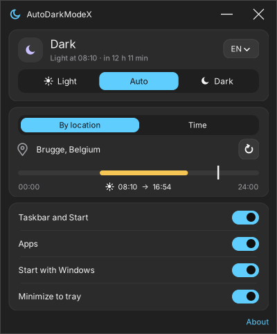

# AutoDarkModeX

Automatically switches Windows between light and dark theme — by sunrise and sunset at your location, or at times you choose.

<p align="center">
  
  
</p>

## Features

- **Three modes:** Light, Auto (on a schedule) and Dark.
- **Schedule by location:** sunrise and sunset are calculated for your place every day, including summer and winter time changes.
- **Schedule by time:** two times of your own for the light and the dark theme.
- **Location:** from the Windows location service or by searching a city by name; coordinates can also be entered by hand.
- **Separate switches** for the taskbar and Start menu and for apps.
- **Runs in the background:** starts with Windows, optional tray icon. The theme also switches while the window is hidden, after waking from sleep and after unlocking; if the taskbar gets stuck in the old theme, the app makes it repaint.
- **Windows 11 look:** rounded corners, Mica background, your Windows accent colour, smooth minimize.
- **Update check:** About → Check for updates looks for a newer release here on GitHub and can download and install it.
- **Languages:** Español, English, Português, Русский, Türkçe, Français, Deutsch, Italiano, Polski, Українська, Nederlands.

## Installation

### ⬇️ [Download the latest version](https://github.com/shakhid/AutoDarkModeX/releases/latest)

Download `AutoDarkModeX-Setup-<version>.exe` from [Releases](../../releases) and run it.
The app installs to `C:\Program Files\AutoDarkModeX` (you can choose another folder). Settings are stored in `%APPDATA%\AutoDarkModeX`.

Requirements: Windows 10 or 11 (.NET Framework 4.x is already part of Windows).

## Building

You need the Mono C# compiler (`mcs`, with Windows Forms) and NSIS (`makensis`):

```sh
./build.sh
```

This produces `AutoDarkModeX.exe` and the installer `AutoDarkModeX-Setup-<version>.exe`. The version is set in the `VERSION` file.

## Project structure

| Path | Contents |
|---|---|
| `src/Main.cs` | main window and theme switching logic |
| `src/Controls.cs` | UI controls and colour palette |
| `src/Core.cs` | settings, translations, location |
| `src/Sun.cs` | sunrise and sunset calculation |
| `src/About.cs` | About window |
| `installer.nsi` | installer (NSIS) |
| `assets/` | icon and screenshots |

---

© 2026 Shax
