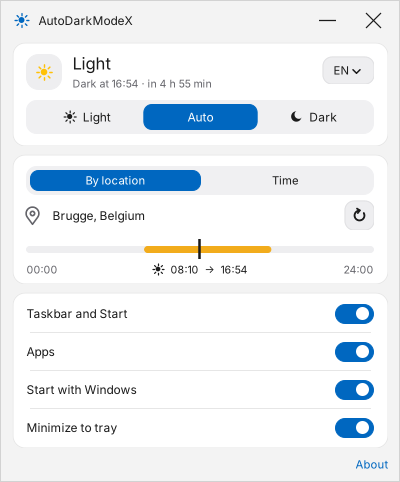

# AutoDarkModeX

Автоматически переключает Windows между светлой и тёмной темой — по восходу и закату в вашем городе или по заданному времени.

*Automatically switches Windows between light and dark theme — by sunrise and sunset at your location, or at set times.*

<p align="center">
  
  
</p>

## Возможности

- **Три режима:** «Светлая», «Авто» (по расписанию), «Тёмная».
- **Расписание по геолокации:** время восхода и заката рассчитывается для вашего места каждый день, с учётом перехода на летнее и зимнее время.
- **Расписание по времени:** два своих времени для светлой и тёмной темы.
- **Местоположение:** через службу геолокации Windows или поиском города по названию; координаты можно ввести вручную.
- **Отдельно для панели задач и «Пуска» и для приложений.**
- **Работает в фоне:** запуск вместе с Windows, значок в трее (по желанию). Тема переключается и при скрытом окне, после выхода из сна и при разблокировке; если панель задач «застряла» в старой теме — программа её перерисовывает.
- **Интерфейс в стиле Windows 11:** скруглённые углы, фон Mica, цвет акцента Windows, плавное сворачивание.
- **Языки:** русский, English, Français, Nederlands, Deutsch.

## Установка

Скачайте `AutoDarkModeX-Setup-<версия>.exe` из раздела [Releases](../../releases) и запустите.
Программа ставится в `C:\Program Files\AutoDarkModeX` (папку можно выбрать). Настройки хранятся в `%APPDATA%\AutoDarkModeX`.

Требования: Windows 10 или 11 (.NET Framework 4.x уже встроен в систему).

## Сборка

Нужны компилятор C# из Mono (`mcs`, с Windows Forms) и NSIS (`makensis`):

```sh
./build.sh
```

Получатся `AutoDarkModeX.exe` и установщик `AutoDarkModeX-Setup-<версия>.exe`. Версия задаётся в файле `VERSION`.

## Структура

| Путь | Что внутри |
|---|---|
| `src/Main.cs` | главное окно и логика переключения |
| `src/Controls.cs` | элементы интерфейса, палитра |
| `src/Core.cs` | настройки, переводы, местоположение |
| `src/Sun.cs` | расчёт восхода и заката |
| `src/About.cs` | окно «О программе» |
| `installer.nsi` | установщик (NSIS) |
| `assets/` | иконка и скриншот |

© 2026 Shax
