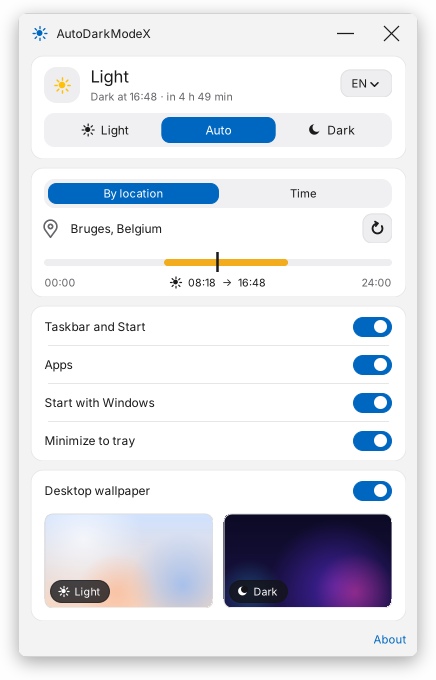
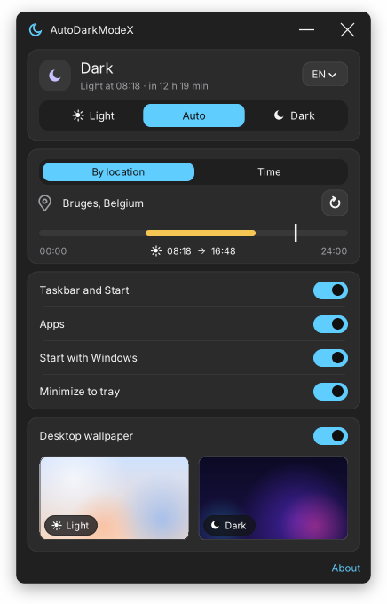
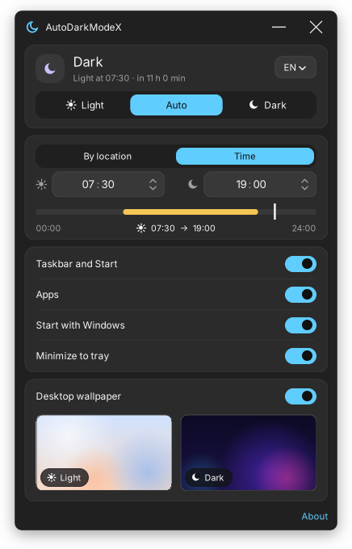
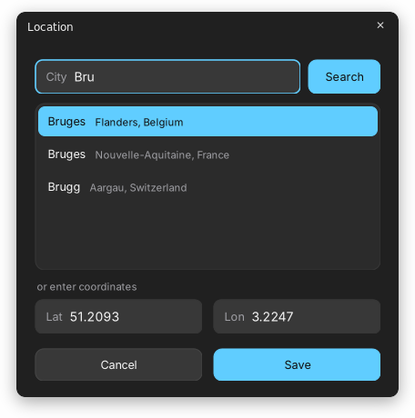
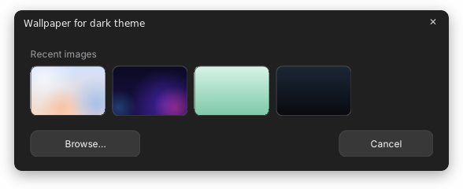
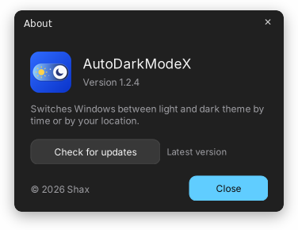

# AutoDarkModeX

Automatically switches Windows between light and dark theme — by sunrise and sunset at your location, or at times you choose.

<p align="center">
  
  
</p>

## About

AutoDarkModeX is a small, free Windows app that keeps your system in the right theme for the time of day. In the morning Windows turns light, in the evening it turns dark — the taskbar, the Start menu and your apps — without you having to open Settings.

Pick **Auto** and the app follows the sun: it works out sunrise and sunset for your city every day, so the switch moves with the seasons and with summer and winter time. Prefer fixed hours? Switch the schedule to **Time** and set your own. **Light** and **Dark** keep one theme until you change it back.

The app starts with Windows and works quietly in the background — even with its window closed, after the PC wakes from sleep and after you unlock it. Optionally it can also change your desktop wallpaper, with one photo for the light theme and one for the dark theme.

## Features

- **Three modes:** Light, Auto (on a schedule) and Dark.
- **Schedule by location:** sunrise and sunset are calculated for your place every day, including summer and winter time changes.
- **Schedule by time:** two times of your own for the light and the dark theme.
- **Location:** from the Windows location service or by searching a city by name; coordinates can also be entered by hand.
- **Separate switches** for the taskbar and Start menu and for apps.
- **Desktop wallpaper per theme** (optional, off by default): one photo for the light theme and one for the dark theme; starts with your current wallpaper and offers your recent Windows wallpapers.
- **Runs in the background:** starts with Windows, optional tray icon. The theme also switches while the window is hidden, after waking from sleep and after unlocking; if the taskbar gets stuck in the old theme, the app makes it repaint.
- **Windows 11 look:** rounded corners, Mica background, your Windows accent colour, smooth minimize.
- **Update check:** About → Check for updates looks for a newer release here on GitHub and can download and install it.
- **Languages:** Español, English, Português, Русский, Türkçe, Français, Deutsch, Italiano, Polski, Українська, Nederlands.

## Screenshots

| Fixed times | Find your city |
|:---:|:---:|
|  |  |
| **Choose a wallpaper** | **Built-in update check** |
|  |  |

## How to use

1. Install the app and leave **Start with Windows** on.
2. Choose **Auto**, then **By location** (sunrise and sunset) or **Time** (your own hours).
3. Click the location line and use **Find city** to search for your city by name, or let the app use the Windows location service.
4. Optional: turn on **Desktop wallpaper** and click each preview to pick a photo for the light and the dark theme.
5. Close the window — the app keeps working in the background.

## Privacy

- No account, no tracking, no ads.
- Your location comes from the Windows location service or from the city you pick; it is stored only on your PC.
- City search sends only the text you type to the Open-Meteo geocoding service.
- The update check reads the latest release from this GitHub repository, and only when you press **Check for updates**.
- Settings and chosen wallpapers stay on your PC in `%APPDATA%\AutoDarkModeX`.

## Installation

### ⬇️ [Download the latest version](https://github.com/shakhid/AutoDarkModeX/releases/latest)

Download `AutoDarkModeX-Setup-<version>.exe` from [Releases](../../releases) and run it.
The app installs to `C:\Program Files\AutoDarkModeX` (you can choose another folder). Settings are stored in `%APPDATA%\AutoDarkModeX`.

Requirements: Windows 10 or 11 (.NET Framework 4.x is already part of Windows).

## Building

You need the Mono C# compiler (`mcs`, with Windows Forms) and NSIS (`makensis`):

```sh
./build.sh
```

This produces `AutoDarkModeX.exe` and the installer `AutoDarkModeX-Setup-<version>.exe`. The version is set in the `VERSION` file.

## Project structure

| Path | Contents |
|---|---|
| `src/Main.cs` | main window and theme switching logic |
| `src/Controls.cs` | UI controls and colour palette |
| `src/Core.cs` | settings, translations, location |
| `src/Sun.cs` | sunrise and sunset calculation |
| `src/Wallpaper.cs` | wallpaper per theme |
| `src/About.cs` | About window |
| `installer.nsi` | installer (NSIS) |
| `assets/` | icon and screenshots |
| `release-notes/` | text of each GitHub release |
| `.github/workflows/release.yml` | builds and publishes a release when `VERSION` changes |

---

© 2026 Shax
